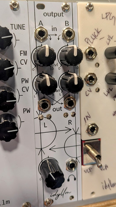

# Output Module

An audio output module for Eurorack, combining two mono input channels into a stereo output with a panning mixer. The stereo output is suitable to drive headphones or small speakers.

* Module size: 6HP (30 mm)
* Power: ?mA (+12V); ?mA (-12V)

!!! repository "Project Source"

    The project files, including schematic and layout, are available on [github](https://github.com/xdylanm/modular-output)

# Features

{align=right}

The output module provides some basic mixing and leveling before forwarding the audio signal to an amplifier for headphones. 

* Two input channels (A and B) with the second normaled to the first. 
* Independent input level adjustments for both channels
* Stereo panning mixer
* Level indicator (red indicates $V_{pp} \gtrapprox 9V$)
* Output volume control
* OPA1688 output amplifiers

## Documentation

[Design](theory.md)

[Assembly Guide](assembly.md)

[Schematic](assets/schematic.pdf)

# References

1. Ray Wilson, "Stereo Mixer" [MFOS](https://musicfromouterspace.com/analogsynth_new/STEREOMIXER2006/STEREOMIXER2006.php)
