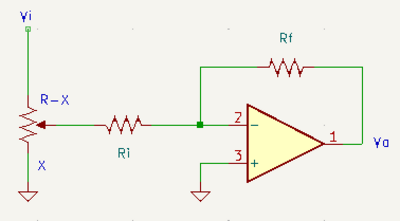
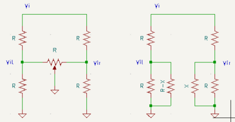

# Theory of Operation

## Input Stage

The Output module accepts line signals (10Vpp) at the inputs. With $R=100\mathrm{k}\Omega$, the input impedance ranges from $R||R_i$ to $R$. The gain of the input stage is $A_i = -\frac{R_f}{R_i}$. Gain options include 2.2 ($R_i = 100k\Omega$, $R_f=220k\Omega$), 4.5 ($R_i=47k\Omega$, $R_f=220k\Omega$) or 10 ($R_i=47k\Omega$, $R_f=470k\Omega$ per MFOS).

## Panning Mixer

At the output of the input gain stage, the panning network sends the signal to the line out buffers and stereo out amplifiers on the left and right channels. Here, the lower fixed $R$ also acts as the input resistance for the inverting summing amplifier (line out buffering), and $V_{o(l|r)} = -\frac{R_{fo}}{R}\left(V_{i(l|r)1} + V_{i(l|r)2}\right)$. With the variable resistor $R$ for panning, the voltages $V_{ir}$ and $V_{il}$ will be in the range $0 \leq V_{i(r|l)} \leq \frac{V_i}{3}$, so an output stage gain of 3 will restore the signal level.

## Audio Amplifier

### Overview

Following the [OPA1688 datasheet](https://www.ti.com/lit/ds/symlink/opa1688.pdf), the initial design requirements are

1. Supply voltage: $24\mathrm{V}$ ($\pm 12\mathrm{V}$)
2. Headphone loads: $16\Omega$ to $600\Omega$
3. THD+N: $>100\mathrm{dB}$ (1kHz fundamental, 1V RMS into a $32\Omega$ load)
4. Output power (before clipping): 50mW into $32\Omega$

In this module, the input signals are single-ended, and the OPA can be configured as a unity gain buffer.

$$
    V_{out} = V_{line}\frac{\alpha R}{R + R'}
$$

where $0 \leq \alpha \leq 1$ corresponds to the pot trim. When $\alpha = 1$ (max. volume), $V_{out} = \frac{V_{line}R}{R+ R'}$, so $R'$ should be chosen according to the desired output level when $V_{line} = 5\mathrm{V}$.

Headphone efficiency relates input power to sound pressure level (SPL). Normal listening ranges from 65dB to 80dB SPL. 70-85dB is  used for mixing and mastering (with peaks up to 110dB SPL), although prolonged listening above 85dB SPL can eventually lead to hearing damage ([according to the internet](https://recordingarts.com/community/tips/samuel-beilman/beginners-guide-listening-levels/)).

The OPA1688 datasheet figure 9-2 shows the input power required for various SPLs depending on headphone efficiency. Some headphones (e.g. Audiotechnica M40X and M50X) can tolerate input power above 1W, while others are limited to 200mW peak (50mW nominal). For efficiencies above 95dB/mW, 115dB SPL is reachable with 100mW and 110dB SPL with 30mW, so the max. 50mW target seems good.

### Unity Gain Design

RMS voltage and current can then be calculated from the input power and headphone impedance:

$$\begin{align*}
V_{out} &= \sqrt{P_{in}R_{hp}} \\
I_{out} &= \sqrt{\frac{P_{in}}{R_{hp}}} 
\end{align*}$$

At $P_{in} = 50\mathrm{mW}$

$R_{hp} (\Omega)$ | $V_{out} (\mathrm{V_{RMS}})$ | $I_{out} (\mathrm{mA_{RMS}})$
------------------|------------------------------|------------------------------
16  | 0.9 | 56
32  | 1.3 | 39
50  | 1.6 | 32
80  | 2.0 | 25
600 | 5.5 | 9.1

To deliver up to $1.4V_{RMS} = 2V_{pk}$, choose $R' = 1.5R$ such that $V_{out} = V_{line}/2.5$. This could be adjusted in a couple of ways:

* choose a larger $R'$ to avoid clipping too early and overdrive the amplifier (the mixed signal can reach $V_{pk} > 10\mathrm{V}$)
* if your headphones are high impedance ($200-600\Omega$), choose a smaller $R'$ to increase $V_{RMS}$

### Limits and Power Dissipation

From the THD+N curves for the OPA1688 (figure 9-3 in the datasheet and table 9-1), clipping occurs before $P_{in}=50\mathrm{mW}$ is delivered to the headphones depending on the amplitude ($V_{RMS}$). A few different factors may contribute to clipping:

1. output headroom: the open-loop output impedance of the OPA is $60\Omega$ in the datasheet, so smaller loads ($16-32\Omega$) create a voltage divider where a significant drop occurs in the output impedance.
2. current limit: the maximum short circuit current for the amplifier is given as 75mA
3. thermal limit: the device has a maximum operating temperature of 125C

The output headroom seems to limit the device in the datasheet: with a $\pm 5V$ supply, the $16\Omega$ clips at $P_{in}=32mW$, equivalent to $I_{out,pk}=63\mathrm{mA}$. That current through $R_{total}=60+16=76\Omega$ results in a voltage drop of 4.8V. 

Moving to $\pm 12V$ rails increases the headroom but also increases the power dissipated by the OPA. The OPA1688 comes in two packages: SOIC and WSON with an exposed pad. The $R_{\theta J A}$ for the SOIC is $116^\circ C/W$ and $63^\circ C/W$ for the WSON. The exposed pad on the WSON significantly improves thermal performance, so I selected that package. Dissipated power is the diffence between supplied power and the power delievered to the load. The current from the supply will depend on the sum of current delivered to the load and the quiescent current, such that the power dissipated per channel is

$$
P_D = 2V_{CC}\left(\frac{I_{out,pk}}{\pi} + I_q\right) - \frac{I^2_{pk}R_L}{2}
$$

where the average current delivered per rail for a sinusoid is the average of a half-wave rectified sinuosid: $2I_{pk}/2\pi$.

For 50mW delivered to a $32\Omega$ load, the single-channel output current is 56mA (peak). The quiescent current is given as 1.6mA per channel in the datasheet. In that scenario, $P_D \simeq 0.4\mathrm{W}$ per channel ($0.8\mathrm{W}$ total), corresponding to a junction temperature rise of $52^\circ C$ ($\sim 77-97^\circ C$ accounting for ambient from $25-45^\circ C$).

## References

1. OPA1688 Datasheet, [ti.com](https://www.ti.com/lit/ds/symlink/opa1688.pdf)
2. OPA1688 Eval Module (OPA1688EVM) Datasheet, [ti.com](https://www.ti.com/lit/ug/sbou186/sbou186.pdf)

